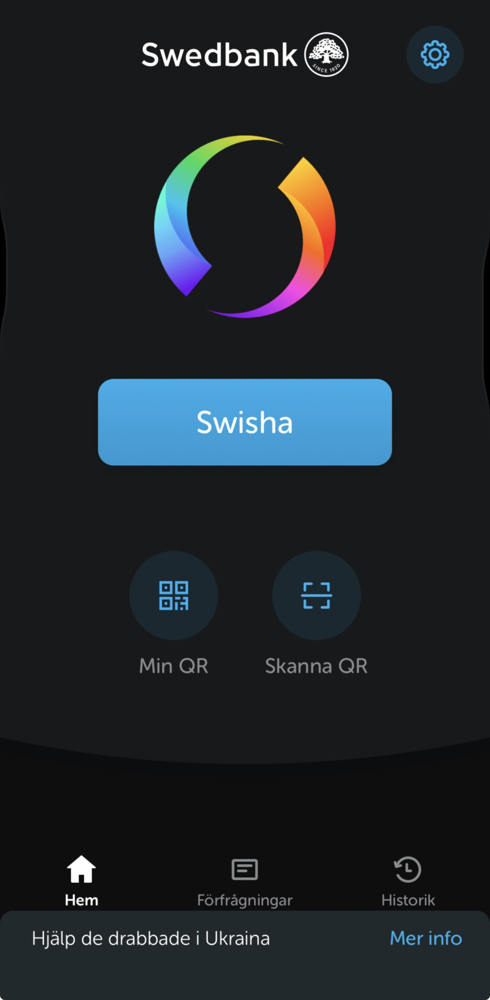

 

  

  <strong>A Swish-inspired prop app for movies, demos, and other stuff.</strong>
    
  
  
    
  <a href="https://github.com/ky2f/Sw1sh/releases/tag/v1.0">⬇️ Download Sw1sh</a>
    
  <a href="https://github.com/ky2f/Sw1sh/issues">🐛 Report a bug</a>
  ·
  <a href="https://github.com/ky2f/Sw1sh/issues">💡 Request a feature</a>

---

## 📱 Screenshots

  

  iOS preview

---

## 📦 Available Versions

Sw1sh is now available in **three formats: iOS, Android, and HTML!**

  

<table>
<tr>
<td width="33%" valign="top">

<h3>🍎 iOS</h3>

Install using a compatible sideloading tool:

- [TrollStore](https://github.com/opa334/TrollStore)
- [Sideloadly](https://sideloadly.io/)
- [AltStore](https://altstore.io/)
- Other compatible sideloaders

<a href="https://github.com/ky2f/Sw1sh/releases/tag/v1.0">Get the release →</a>

</td>
<td width="33%" valign="top">

<h3>🤖 Android</h3>

1. Download the APK.
2. Open your file manager.
3. Tap the file and follow the installation prompts.

You may need to allow installations from your file manager.

<a href="https://github.com/ky2f/Sw1sh/releases/tag/v1.0">Get the release →</a>

</td>
<td width="33%" valign="top">

<h3>🌐 HTML</h3>

Sw1sh is now available in HTML format, allowing you to use the web version through a compatible browser.

1. Download the HTML file.
2. Open it in your browser.
3. Start using the web version.

<a href="https://github.com/ky2f/Sw1sh/releases/tag/v1.0">Get the release →</a>

</td>
</tr>
</table>

---

## 🛠️ About

The original Android APK comes from **FoeXploit**. I've modified the APK and adapted it into an iOS `.IPA` version. Sw1sh is now also available in HTML format.

This is an unofficial community project.

---

## 🔄 Updates

Updates are planned approximately every **1–2 weeks**, depending on development progress. This is a target, not a guarantee. Releases will be published when they're ready.

---

## ⚠️ Disclaimer

Sw1sh is an unofficial modified project. It is not affiliated with or endorsed by the original Swish developers or FoeXploit.

